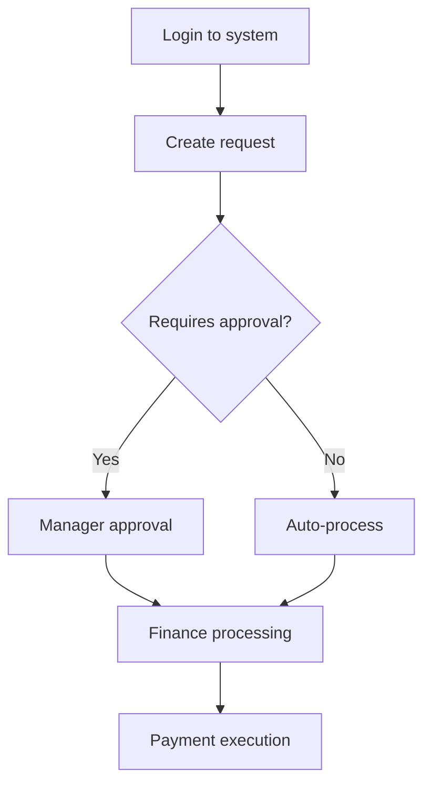

# Process Flow Builder

Convert process documentation (Word docs, SOPs, verbal descriptions) into structured process flow tables ready for Google Sheets.

## Output Format

Generate THREE outputs:

1. **React JSX artifact** - Interactive table for review and editing
2. **TSV code block** - Tab-separated values for direct copy to Google Sheets
3. **Mermaid flowchart** (optional) - Visual process diagram when requested or when helpful for complex workflows

All table outputs must have these columns:

```
Step	Task	Activities/Outputs	Owner	People informed	Due by	Comments / Automations
```

**Column specifications:**

- **Step**: Hierarchical numbering (1, 1.1, 1.2, 2, 2.1, etc) for sub-steps
- **Task**: Brief action-oriented title. For PARENT steps only (1, 2, 3, not 1.1, 1.2), capitalize KEY DIFFERENTIATING WORDS (e.g., "Login to APPROVALMAX", "Create new PURCHASE ORDER", "Attach SUPPORTING DOCUMENTS")
- **Activities/Outputs**: Succinct description (target 150 chars, warn at 180, absolute max 200), multiple items comma-separated, max 2 hyperlinks in markdown format [text](url)
- **Owner**: Single role or person responsible. If multiple options, use spaces around slash: "Consultant / Requester" not "Consultant/Requester"
- **People informed**: Comma-separated list of roles/people who need notification. Use spaces around slashes
- **Due by**: Deadline relative to process start or specific date/frequency
- **Comments / Automations**: Target 150 chars, warn at 180, absolute max 200. Only add where valuable, leave blank otherwise. For automations: prefix "AUTOMATE:" (only if easy OR high-value). For optimizations: prefix "SUGGEST:" (only if saves time or adds value). Max 2 hyperlinks.

## Character Limit Management

When content exceeds 180 characters (warning threshold):
1. Flag to user: "⚠️ Row X exceeds recommended length"
2. Present SHORT version (under 150 chars) and LONG version (under 200 chars)
3. Let user choose which to include
4. Only do this if necessary - default to SHORT version

Example:
```
⚠️ Step 2 Activities exceeds 180 chars

SHORT (145 chars): Click 'New Request', enter contact/date/currency, complete line items (description, quantity, price, account, project)
LONG (195 chars): Click 'New Request', enter contact details (beneficiary, add supplier if needed), select date and delivery per calendar, choose theme/currency, complete all line items with descriptions

Which version? [SHORT / LONG / Edit]
```

## JSX Editing and Synchronization

When user edits the JSX artifact:
1. Note all changes made to the React component data
2. Apply identical changes to TSV output
3. Present updated TSV code block
4. Confirm synchronization: "Updated TSV to reflect JSX changes"

The JSX artifact enables interactive review and editing. The TSV code block is the final output for copying to Google Sheets. These must always contain identical data.

## Input Processing

### From Word Documents / SOPs
1. Read the entire document structure
2. Identify process steps (often in numbered lists, sections, or sequential paragraphs)
3. Extract timing information (look for "monthly", "by X date", "within Y days")
4. Identify roles from context (reviewers, approvers, processors)
5. Break complex steps into sub-steps when they involve:
   - Multiple distinct actions
   - Different owners within same step
   - Sequential dependencies
   - Decision points

### From Conversational Input
1. Ask clarifying questions about:
   - Process frequency/timing
   - Key roles involved
   - Decision points or approvals
   - Current pain points (for automation suggestions)
2. Structure the conversation into logical sequential steps
3. Identify implicit sub-steps

## Data Inference Rules

### When information is missing:

**Owner assignment:**
- Review/approve actions → Senior role or manager
- Create/draft actions → Team member or executor
- Submit actions → Requester
- Process/execute actions → Operations team
- If uncertain → "Team *TBC"

**Due dates:**
- Reviews/approvals → 2-3 days after previous step
- Data entry → 1 day
- Board approvals → "Monthly board meeting *TBC"
- Month-end processes → Specific date of month
- If uncertain → "TBC timing *TBC"

**People informed:**
- Process initiator at completion
- Budget owners for spending steps
- Next step owner when their action is ready
- If uncertain → Leave blank

**Flag all inferred data with *TBC suffix**

## Automation Suggestions

Load references/automation_patterns.md for comprehensive patterns. 

**Selection criteria - only suggest if:**
- Easy to implement: <1 hour setup (e.g., existing tool integration, simple script), OR
- High-value impact: Saves >3 hours/month OR eliminates critical bottleneck

**Format requirements:**
- Prefix with "AUTOMATE:"
- Max 200 characters total for entire Comments/Automations column
- Be specific about tools/methods
- Include hyperlinks to tools where relevant (max 2 per row)

**Common high-value automations:**
- Approval routing → Workflow tools (ApprovalMax, Jira)
- Repetitive data entry → API integration
- Document generation → Template automation
- Deadline tracking → Automated reminders

**Easy automations:**
- Auto-populate current date
- Dropdown menus from databases
- Email notifications on status change
- Pre-fill forms from CRM

Be specific about tools/methods when context suggests particular solutions. Skip automation suggestions where they add little value or are complex to implement.

## Optimization Suggestions

In the same Comments/Automations column, add process optimization suggestions prefixed with "SUGGEST:". Base recommendations on:
- Industry best practice for the organization type
- Cutting-edge thinking in process design
- Lean principles (eliminate waste, reduce handoffs)
- Common bottlenecks in similar workflows

**Only suggest if:**
- Will demonstrably save time
- Adds measurable value
- Addresses clear inefficiency

**Format:**
- Prefix with "SUGGEST:"
- Ultra-succinct (few words)
- Combined with automations in same 200-char limit

**Common optimization patterns:**
- Parallel approvals instead of sequential
- Eliminate redundant review steps
- Combine similar data entry steps
- Self-service options instead of requests
- Pre-approval for low-value items

## Examples

### With automation AND optimization:
```
Step	Task	Activities/Outputs	Owner	People informed	Due by	Comments / Automations
1	Review RISK MATRIX	Access [risk matrix](link), assess risks, add comments	Team	Risk owners	8th of month	AUTOMATE: Form app for input. SUGGEST: Parallel review by regions
```

### With optimization only:
```
Step	Task	Activities/Outputs	Owner	People informed	Due by	Comments / Automations
3	Manager APPROVAL	Review budget, approve or reject	Manager	Requester	3 days	SUGGEST: Pre-approve items <£500
```

### Max 2 hyperlinks per row:
```
Step	Task	Activities/Outputs	Owner	People informed	Due by	Comments / Automations
2	Convert CURRENCY	Use [EC tool](https://ec.europa.eu/...), document original amount	Consultant		Same day	AUTOMATE: [API integration](link)
```

### Character limit warning example:
```
⚠️ Step 2 Activities exceeds 180 chars (current: 195)

SHORT (148 chars): Enter contact/date/currency details, complete line items (description, quantity, price, account code, project)
LONG (195 chars): Enter contact details (beneficiary name, add supplier if needed), select current date and delivery date per calendar, choose theme and currency, complete all line items

Recommend: SHORT
```

### Good sub-step decomposition (when needed):
```
Step	Task	Activities/Outputs	Owner	People informed	Due by	Comments / Automations
2	Process INVOICE	Verify invoice against PO	Finance Team	Requester	3 days	AUTOMATE: Matching engine
2.1	Check budget	Confirm funds available	Finance Team		3 days	AUTOMATE: Real-time dashboard
2.2	Route to approver	Send to manager by threshold	Finance Team	Approver	3 days	SUGGEST: Parallel approvals >£10k
```

### Consolidation example (preferred):
**Instead of:**
```
2.1	Enter contact name
2.2	Enter contact email  
2.3	Select project
```

**Do this:**
```
2	Enter CONTACT DETAILS	Enter name, email, select project	Consultant		Same day	AUTOMATE: Auto-suggest from previous
```

### Owner with spaces around slash:
```
Step	Task	Activities/Outputs	Owner	People informed	Due by	Comments / Automations
1	Submit REQUEST	Complete form, attach documents	Consultant / Requester		Same day	
```

### Blank comments (no value to add):
```
4	Review and SUBMIT	Verify details, click Submit	Requester		Same day	
```

## Process Flow

1. Receive input (document or conversation)
2. If document: Read and analyse structure
3. If conversation: Ask clarifying questions
4. Load references/automation_patterns.md for automation ideas
5. Generate step-by-step breakdown with sub-steps where appropriate
6. **Consolidate**: Merge steps with same owner and due date to reduce row count. Aim for maximum 15 parent steps and 30 total rows
7. Infer missing data using heuristics (flag with *TBC)
8. Add automation suggestions (only if easy: <1 hour setup OR high-value: saves >3 hours/month OR critical bottleneck)
9. Add optimization suggestions (only if demonstrably saves time or adds value)
10. Include hyperlinks to systems, tools, and URLs mentioned in source material (max 2 per row)
11. Apply capitalization rules to parent step tasks
12. Check character limits (warn if >180, max 200), present SHORT and LONG options if needed
13. Output as JSX artifact first (for review/editing)
14. Output as TSV code block (for copying to Google Sheets)
15. Output as Mermaid flowchart if requested or if helpful for complex workflows
16. Confirm all formats are synchronized

## Mermaid Flowchart Generation

Create visual process flow using Mermaid when:
- User explicitly requests visual output
- Process is complex with multiple decision points
- Helpful to show parallel workflows

**Mermaid format guidelines:**
- Use `flowchart TD` (top-down) or `flowchart LR` (left-right) based on process structure
- Represent steps as rounded rectangles: `A[Step name]`
- Represent decisions as diamonds: `B{Decision?}`
- Show parallel processes with appropriate branching
- Keep node labels concise (max 40 chars)
- Use meaningful node IDs
- Show sub-steps as indented nodes when critical

**Example structure:**


## Consolidation Guidelines

When consolidating to reduce row count:
- Merge sequential sub-steps with same owner and timing into parent step
- Combine similar activities in objectives column (comma-separated)
- Keep sub-steps only when different owners, timing, or clear decision points
- Prioritize clarity over granularity

## Hyperlink Guidelines

Include clickable hyperlinks for:
- System URLs (e.g., https://app.approvalmax.com)
- Tool names that have known URLs
- Referenced documents or templates
- External resources mentioned in source

Format in markdown: [Link text](URL)

## Quality Checks

Before outputting:
- Total rows ≤30, parent steps ≤15 (consolidate where possible)
- All steps numbered logically (no gaps, proper sub-step hierarchy)
- Each step has clear action verb in task name
- Parent step tasks (1, 2, 3) have KEY WORDS capitalized (not sub-steps like 1.1, 1.2)
- Activities/Outputs column: target 150 chars, warn if >180, absolute max 200
- Comments/Automations column: target 150 chars, warn if >180, absolute max 200
- Comments column blank unless adding clear value
- Automation suggestions: prefixed "AUTOMATE:", only if easy (<1 hour setup) OR high-value (saves >3 hours/month OR critical bottleneck)
- Optimization suggestions: prefixed "SUGGEST:", only if demonstrably saves time or adds value
- Max 2 hyperlinks per row (markdown format)
- Owner uses spaces around slashes: "Consultant / Requester" not "Consultant/Requester"
- Owner assigned (even if *TBC)
- JSX, TSV, and optional Mermaid outputs are all synchronized with identical data
- Format is clean TSV in code block (no extra formatting characters)
- Present SHORT and LONG versions for rows exceeding 180 chars
